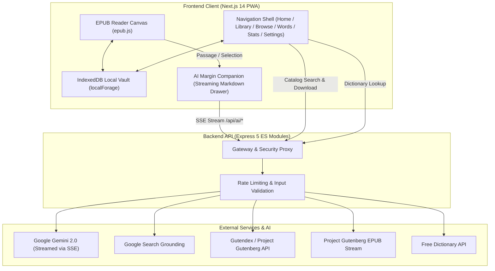

# Flyleaf — AI-Powered Editorial E-Reader

> A distraction-free, local-first digital reading sanctuary combining classic book typography with on-demand AI literary assistance, offline vault storage, and an editorial design system.

---

## Overview

**Flyleaf** is an AI-powered e-reader engineered for mobile, tablet, and desktop. It bridges the tranquility of fine print typography with the analytical depth of modern artificial intelligence. Readers can discover public-domain literature from Project Gutenberg, download and preserve volumes completely offline in a local browser vault, and engage with a context-aware AI margin companion that explains literary subtext, historical background, and vocabulary in real time.

Built on the **Flyleaf Editorial Design Specification**, the interface prioritizes quiet chrome, content-first layouts, and WCAG AA contrast across four curated palettes—all without decorative clutter, animations for their own sake, or hardcoded colors.



---

## Key Features

### 📖 Distraction-Free Reader Canvas (`/reader/[id]`)
- **Fluid Paginated EPUB Engine:** Paginated rendering powered by `epub.js`, calibrated to eliminate overflow, horizontal scroll, and scrollbar leaks.
- **Viewport-Responsive Layout Math:** Zero layout shift across phone (320px–767px), tablet (768px–1023px), and desktop (1024px+).
- **Appearance & Typography Controls:**
  - Switchable editorial typefaces: **Newsreader** (classic serif), **Literata** (book serif), and **Inter** (clean sans-serif).
  - Granular controls for font size, line height, and stage margins.
  - Palette selector with instant synchronization between the reader iframe and application shell.
- **Reading Gestures & Navigation:** Tap zones, smooth quick-flick swipe page turns, keyboard shortcuts (`Arrow` keys, `Space`, Vim `h`/`l`), chapter TOC drawer, and instant in-book text search.
- **Text Selection Action Bar:** Highlight passages with note taking, dictionary lookup, and one-tap "Ask AI" queries.

### 🤖 Context-Aware AI Margin Companion (`AiDrawer`)
- **Streaming Server-Sent Events (SSE):** Token-by-token real-time streaming directly from Google Gemini 2.0.
- **Deep Literary Analysis:** Explanations of metaphor, subtext, character dynamics, and cultural references for selected text.
- **Strict Anti-Spoiler Guardrails:** Context-constrained system instructions prevent the model from revealing plot points ahead of the reader's current location.
- **Chapter Summaries:** High-level narrative arcs and chapter recaps with input length capping.
- **Google Search-Grounded Author Research:** Real-time search grounding verifies author biographies, historical eras, and publication context.

### 🏛️ Unified 6-Tab Navigation Shell
All 6 main tabs follow a standardized 3-part editorial header structure (**Eyebrow** → **Serif Display `<h1>`** → **Subtitle**) locked into an identical container geometry (`max-w-2xl mx-auto px-5 pt-7 pb-28`):

1. **Home (`/`) — `SANCTUARY VAULT`:** Dynamic time-of-day greeting, recent reading hero carousel with progress indicator, weekly reading telemetry, "Look what fell out" serendipitous highlight/word card, and quick import actions.
2. **Library (`/library`) — `PERSONAL ARCHIVE`:** Multi-view collection manager with **Shelf View** (dynamic spine heights calculated from book page counts), **Grid View**, and **List View**; segmented status filters (*All*, *Reading*, *Finished*); title and author search with multi-criteria sorting.
3. **Browse (`/browse`) — `PUBLIC DOMAIN CATALOG`:** Live catalog discovery via Project Gutenberg / Gutendex; curated topic chips (*All Classics*, *Philosophy*, *Gothic Fiction*, *Russian Lit*, *Sci-Fi & Fantasy*, *Poetry*, *Essays*); search with instant download and vault import.
4. **Words (`/vocabulary`) — `PERSONAL LEXICON`:** Personal lexicon of saved vocabulary words with phonetic audio pronunciation (Web Speech API), contextual sentence highlighting (italic serif with bronze underline), spaced-repetition review triggers (*Review Soon* / *Remembered*), and interactive Flashcard Quiz Mode.
5. **Stats (`/stats`) — `READING ANALYTICS`:** 26-week activity heatmap, total reading time counter, pages turned, current streak tracker, and completed volumes breakdown.
6. **Settings (`/settings`) — `PREFERENCES`:** Reader display name and avatar editor (with client-side canvas resizing), 4-palette theme switcher, IndexedDB vault storage usage breakdown, full JSON archive + EPUB binary backup/export, archive restore, and vault erase.

### 🎨 Flyleaf Editorial Design System
- **Quiet Chrome:** Minimal chrome footprint that recedes into the reading surface until explicitly invoked.
- **One Accent:** A single warm bronze accent (`#855224` in Paper) reserved strictly for reading progress lines, active states, links, and focal highlights.
- **Four Editorial Palettes (WCAG AA Compliant $\ge$ 4.5:1):**
  - **Paper:** `#FAF9F6` background, `#152A41` ink (Classic high-grade book paper)
  - **Sepia:** `#F4ECD8` background, `#2C2214` ink (Warm vintage library tone)
  - **Night:** `#141824` background, `#F0F2F5` ink (Calm, low-blue dark mode)
  - **OLED:** `#000000` background, `#EDEDED` ink (True black contrast for OLED mobile displays)
- **Zero Flash Initial Paint:** Inline blocking theme restoration script in `app/layout.js` eliminates white flashes during navigation and hard refreshes.
- **Calm Perceived Performance:** Skeletons replace jarring loading spinners; micro-interactions use restrained button press physics (`scale(0.98)`).
- **Token Integrity:** Zero hardcoded colors in source code; verified by automated static code inspection.

### 💾 100% Local-First Offline Vault
- All volumes, metadata, EPUB binary blobs, bookmarks, highlights, and vocabulary terms are stored locally in IndexedDB.
- Fully functional without an internet connection once books are imported or downloaded.
- Complete data ownership: full exportable vault archives (JSON metadata + EPUB binaries) and local restoration.

---

## Tech Stack

| Layer | Technologies |
| :--- | :--- |
| **Frontend Framework** | [Next.js 14](https://nextjs.org/) (App Router), [React 18](https://react.dev/) |
| **Reader Engine** | [epub.js](https://github.com/futurepress/epub.js/) |
| **Styling & Design** | [Tailwind CSS](https://tailwindcss.com/), CSS Custom Properties (Theme Palettes) |
| **Typography** | Newsreader Variable, Literata Variable, Inter Variable (`@fontsource-variable`) |
| **Offline Storage** | IndexedDB, [localForage](https://localforage.github.io/localForage/) |
| **Backend Runtime** | [Node.js](https://nodejs.org/) (ES Modules) |
| **API Framework** | [Express 5](https://expressjs.com/), `cors`, `dotenv`, `express-rate-limit` |
| **AI Orchestration** | [Google Gemini 2.0](https://ai.google.dev/) via `@google/genai` (Streaming SSE) |
| **External APIs** | [Gutendex](https://gutendex.com/), Project Gutenberg, [Free Dictionary API](https://dictionaryapi.dev/) |
| **Testing & QA** | Node.js Test Runner (Unit & PBT), [Playwright](https://playwright.dev/) (Visual & Contrast Suite) |

---

## Repository Layout

```
ai-kindle-reader/
├── backend/                        # Express 5 API Service
│   ├── src/
│   │   ├── controllers/            # AI streaming, catalog proxy, and dictionary controllers
│   │   ├── middleware/             # Rate limiting, error handling, and request validation
│   │   ├── routes/                 # Express route definitions (/api/ai, /api/catalog, etc.)
│   │   └── utils/                  # Gemini client and streaming helper functions
│   ├── app.js                      # Express application setup and CORS configuration
│   ├── index.js                    # Server entrypoint (Port 8000)
│   └── package.json
│
├── frontend/                       # Next.js 14 Progressive Web App
│   ├── app/
│   │   ├── (app)/                  # Main Navigation Shell
│   │   │   ├── page.js             # Home Dashboard (Sanctuary Vault)
│   │   │   ├── library/page.js     # Library (Shelf / Grid / List)
│   │   │   ├── browse/page.js      # Browse The Commons (Project Gutenberg)
│   │   │   ├── vocabulary/page.js  # Words (Personal Lexicon & Quiz Mode)
│   │   │   ├── stats/page.js       # Stats (Reading Telemetry Heatmap)
│   │   │   └── settings/page.js    # Settings & Vault Management
│   │   ├── (focus)/
│   │   │   ├── reader/[id]/page.js # Fullscreen Paginated EPUB Reader
│   │   │   └── book/[id]/page.js   # Book Detail Screen
│   │   ├── layout.js               # Root layout with zero-flash theme script
│   │   └── globals.css             # Theme palettes, typography tokens, and base styles
│   ├── components/
│   │   ├── ui/                     # Editorial UI library (PageHeader, Button, Segmented, etc.)
│   │   ├── reader/                 # Reader controls, appearance modal, search, and gestures
│   │   ├── AiDrawer.jsx            # Streaming SSE AI margin companion
│   │   └── AppShell.jsx            # Responsive navigation shell (Rail on desktop, bar on mobile)
│   ├── lib/
│   │   ├── api.js                  # Centralized backend HTTP & SSE client
│   │   └── format.js               # Reading time and volume formatting utilities
│   ├── utils/
│   │   └── db.js                   # IndexedDB local vault persistence engine
│   ├── scripts/
│   │   ├── ui-check.mjs            # Automated Playwright test suite (417 design & contrast checks)
│   │   └── reader-check.mjs        # Reader layout and pagination smoke test
│   ├── tests/                      # Unit, preservation, and property-based tests (PBT)
│   ├── DESIGN.md                   # Complete Flyleaf Editorial Design Specification
│   ├── tailwind.config.js          # Design tokens and theme color mappings
│   └── package.json
│
├── PRD.md                          # Full Product Requirements Document
└── README.md                       # Project documentation (this file)
```

---

## Getting Started

### Prerequisites

- **Node.js:** Version 20.0.0 or later
- **Package Manager:** `npm` (included with Node.js)
- **Gemini API Key:** Obtain an API key from [Google AI Studio](https://aistudio.google.com/)

---

### 1. Setup and Run the Backend API

1. Navigate to the backend directory:
   ```bash
   cd ai-kindle-reader/backend
   npm install
   ```

2. Create your local environment configuration:
   ```bash
   touch .env.local
   ```

3. Populate `.env.local` with the following:
   ```env
   PORT=8000
   GEMINI_API_KEY=your_gemini_api_key_here
   # Optional: Comma-separated allowed origins (defaults to http://localhost:3000)
   CORS_ORIGIN=http://localhost:3000
   ```

4. Start the backend development server:
   ```bash
   npm start
   ```

5. Verify that the backend is running:
   ```bash
   curl http://localhost:8000/health
   # Expected response: {"status":"ok","timestamp":"..."}
   ```

---

### 2. Setup and Run the Frontend Client

1. Open a new terminal window and navigate to the frontend directory:
   ```bash
   cd ai-kindle-reader/frontend
   npm install
   ```

2. Create `.env.local` (optional if using local defaults):
   ```bash
   touch .env.local
   ```

3. Add the backend URL to `.env.local`:
   ```env
   NEXT_PUBLIC_API_URL=http://localhost:8000
   ```
   *(Note: `next.config.mjs` automatically handles API rewrites so that `/api/*` routes are proxied to the backend with zero CORS issues).*

4. Start the Next.js development server:
   ```bash
   npm run dev
   ```

5. Open [http://localhost:3000](http://localhost:3000) in your browser.

---

## API Reference

The backend Express service exposes clean REST and SSE streaming endpoints:

### Health & Diagnostics
| Method | Endpoint | Description |
| :--- | :--- | :--- |
| `GET` | `/health` | Service health status and timestamp |

### Catalog & Book Delivery
| Method | Endpoint | Description |
| :--- | :--- | :--- |
| `GET` | `/api/catalog/search?q=&page=` | Search Project Gutenberg catalog (returns only books with valid EPUB files) |
| `GET` | `/api/catalog/browse?topic=&languages=&sort=&page=` | Browse catalog by literary topic with pagination |
| `GET` | `/api/catalog/book/:id` | Fetch metadata and cover information for a single book |
| `GET` | `/api/catalog/download/:bookId` | CORS-compliant stream proxy for `.epub` binary download |

### Dictionary Lookup
| Method | Endpoint | Description |
| :--- | :--- | :--- |
| `GET` | `/api/lookup/define?word=&lang=` | Fetch definitions, phonetics, audio, and parts of speech |

### Contextual AI Engine (Server-Sent Events)
| Method | Endpoint | Protocol | Description |
| :--- | :--- | :--- | :--- |
| `POST` | `/api/ai/assist` | SSE | Stream passage analysis with anti-spoiler guards |
| `POST` | `/api/ai/summary` | SSE | Stream structured chapter summaries (input capped) |
| `POST` | `/api/ai/author-grounding` | SSE | Stream author background grounded in live Google Search |

---

## Testing & Quality Assurance

Flyleaf includes an extensive automated verification pipeline ensuring design fidelity, layout stability, accessibility, and offline persistence:

### 1. Unit & Property-Based Tests (PBT)
Tests reader pagination formulas, debounce timings, MutationObserver container styling, and CSS variable inheritance:
```bash
cd ai-kindle-reader/frontend
npm test
```
*Runs 47 automated property-based, preservation, and unit tests using the native Node.js test runner.*

### 2. Playwright UI Design & Contrast Suite
Smoke-tests all routes (`/`, `/library`, `/browse`, `/stats`, `/vocabulary`, `/settings`, `/reader/[id]`) across all 4 palettes and 3 viewport dimensions:
```bash
cd ai-kindle-reader/frontend
npm run check:ui
```
*Validates 417 checks covering:*
- **Zero Horizontal Overflow:** Verifies `scrollWidth <= innerWidth` across all screens.
- **WCAG AA Contrast ($\ge$ 4.5:1):** Audits contrast on all text elements across Paper, Sepia, Night, and OLED themes.
- **Mobile Touch Targets ($\ge$ 44×44px):** Confirms all buttons, chips, tabs, and inputs meet accessibility standards on touch devices.
- **Static Color Audit:** Verifies zero hardcoded hex colors exist in production UI code.
- **Contact Sheet Generation:** Saves visual contact sheet renders for all 4 palettes to `scripts/out/`.

---

## Security & Privacy

- **Server-Side API Key Isolation:** The Gemini API key is never exposed to the client or bundled in frontend assets.
- **Input Validation & Capping:** Requests sent to AI endpoints are sanitized and capped (e.g., 50,000 characters for chapter summaries) to mitigate prompt-injection and runaway token usage.
- **Rate Limiting:** Protects backend endpoints against brute-force calls and abuse via `express-rate-limit`.
- **Local-First Privacy:** Reading progress, notes, vocabulary, and books are stored directly in your browser's IndexedDB. No telemetry or reading habits are shared with third parties without explicit authentication.

---

## License

This project is licensed under the MIT License. Public domain literature provided through the Project Gutenberg and Gutendex APIs is subject to the respective Project Gutenberg license terms.
