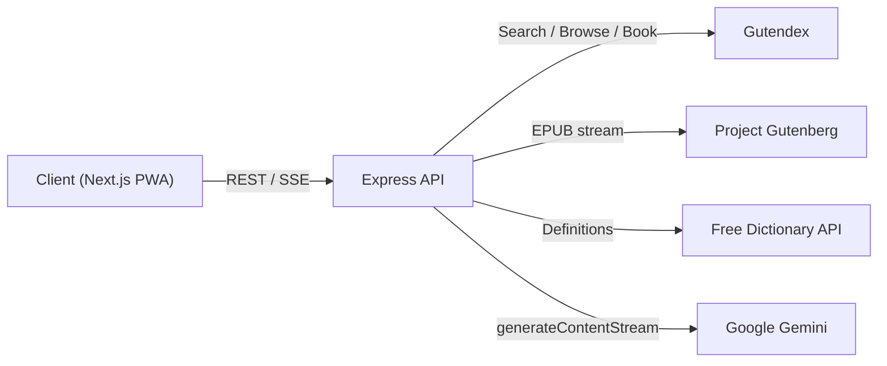

# AI Kindle Reader

An AI-powered, Kindle-style e-reader for mobile and web. Readers can discover public-domain classics, download them for offline reading, and get contextual help while they read: explanations of highlighted passages, chapter summaries, dictionary lookups and author background research.

> **Project status:** In active development.
> The backend API is implemented. The Next.js frontend is next.

## Features

### Implemented (backend)

- **Contextual AI assistance:** Streamed explanations of highlighted passages, covering metaphor, subtext and vocabulary. Prompts are written to avoid spoilers beyond the current chapter.
- **Chapter summaries:** Streamed summaries with a 50,000-character input cap.
- **Author grounding:** Author and historical research that uses Google Search grounding.
- **Catalog discovery:** Search, browse and single-book lookup over the Project Gutenberg catalog through [Gutendex](https://gutendex.com). Only books with an EPUB are returned.
- **EPUB download proxy:** Streams `.epub` files through the server to avoid CORS problems in the browser.
- **Dictionary lookup:** Phonetics, parts of speech and definitions from the [Free Dictionary API](https://dictionaryapi.dev).
- **Consistent API contract:** Standard success and error envelopes with centralized error handling.

### Planned

- Next.js reader with paginated EPUB rendering (`epub.js`)
- Offline library using IndexedDB (`localForage`)
- Themes and typography controls (Day, Sepia, OLED Night)
- AI drawer with live-streamed markdown
- PWA support (installable, offline shell)
- Rate limiting and quota throttling

See [PRD.md](../PRD.md) for the full roadmap.

## Architecture



The API keeps the Gemini key on the server and never exposes it to the client. AI responses are delivered as Server-Sent Events, so text appears as it is generated.

## Repository Layout

```
ai-kindle-reader/
├── backend/     # Express API (implemented)
└── frontend/    # Next.js client (scaffolded, not implemented)
```

## Tech Stack

| Layer | Technology |
| --- | --- |
| Runtime | Node.js (ES Modules) |
| API | Express 5, `cors`, `dotenv` |
| AI | Google Gemini via `@google/genai` |
| Data sources | Gutendex, Project Gutenberg, Free Dictionary API |
| Frontend (planned) | Next.js, `epub.js`, `localForage`, Tailwind CSS |

## Getting Started

### Prerequisites

- Node.js 20 or later
- A Gemini API key from [Google AI Studio](https://aistudio.google.com)

### Run the backend

```bash
cd backend
npm install
```

Create `backend/.env.local`:

```env
PORT=8000
GEMINI_API_KEY=your_gemini_api_key
# Optional, comma-separated list of allowed origins
# CORS_ORIGIN=http://localhost:3000
```

Start the server:

```bash
node --watch index.js
```

The API is available at `http://localhost:8000`. Verify it with:

```bash
curl http://localhost:8000/health
```

## API Overview

| Method | Endpoint | Description |
| --- | --- | --- |
| GET | `/health` | Service health check |
| GET | `/api/lookup/define?word=&lang=` | Dictionary definition |
| GET | `/api/catalog/search?q=&page=` | Search the catalog |
| GET | `/api/catalog/browse?topic=&languages=&sort=&page=` | Browse the catalog |
| GET | `/api/catalog/book/:id` | Single book details |
| GET | `/api/catalog/download/:bookId` | Stream an EPUB |
| POST | `/api/ai/assist` | Explain a highlighted passage (SSE) |
| POST | `/api/ai/summary` | Summarize a chapter (SSE) |
| POST | `/api/ai/author-grounding` | Search-grounded author research (SSE) |

Full request and response details are in the [backend README](./backend/README.md).

## Security

- The Gemini API key is read from server-side environment variables only.
- `.env.local` is git-ignored. Never commit credentials.
- Request bodies are limited to 2 MB, and AI inputs are validated.
- CORS is restricted to configured origins.

## Roadmap

- [x] Phase 1: Backend API (catalog, dictionary, AI streaming)
- [ ] Phase 2: Frontend client (reader canvas, offline storage, themes)
- [ ] Phase 3: AI integration in the client (streaming drawer, context engine)
- [ ] Rate limiting and response caching

## License

No license has been specified yet.
